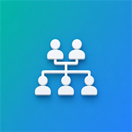
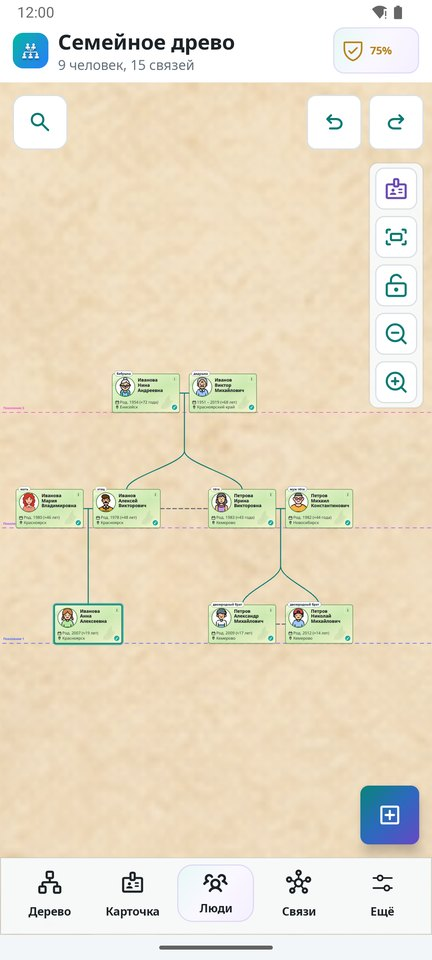
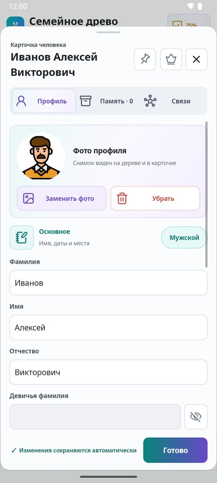
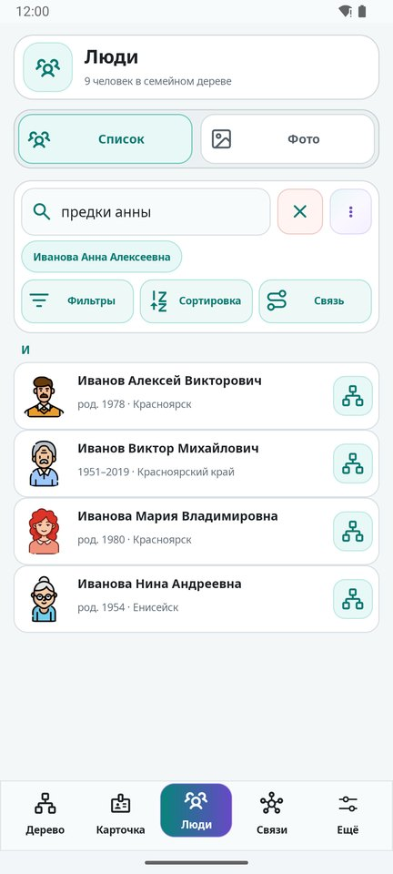
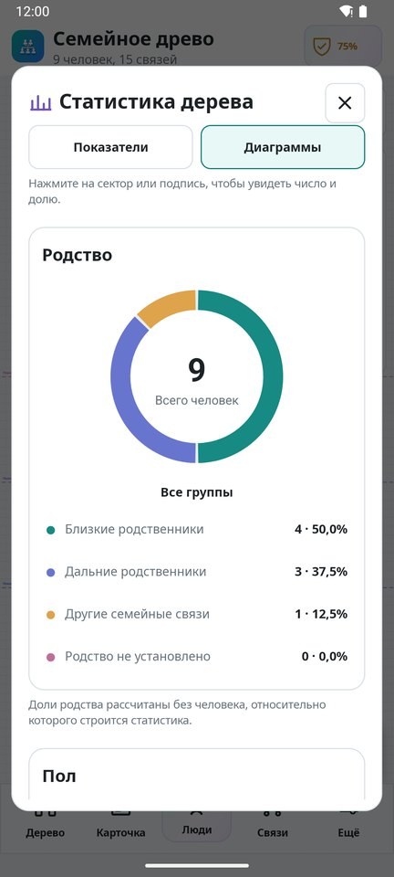
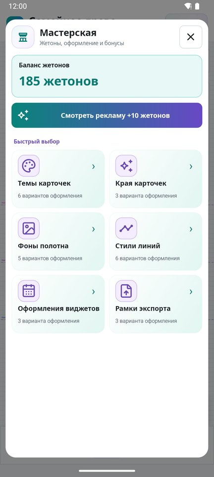
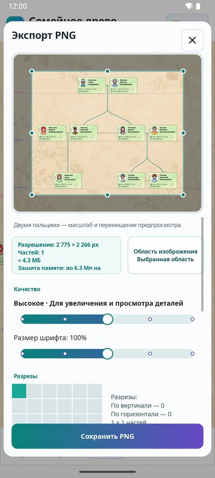

<div align="center">



# Family Tree DS

**Семейное древо в телефоне: родные, фото, даты и истории — в одном месте.**

[](https://github.com/DrShapaya/Family-Tree-DS/releases/latest)


[](https://t.me/FamilyTreeDS)

[**Скачать в RuStore**](https://www.rustore.ru/catalog/app/ru.drshapaya.familytree) ·
[**APK на GitHub**](https://github.com/DrShapaya/Family-Tree-DS/releases/latest) ·
[История изменений](CHANGELOG.md) ·
[Чат](https://t.me/ChatFamilyTree)

</div>

<p align="center">
  
  
  
  
</p>

Family Tree DS — бесплатное нативное Android-приложение для родословной.
Работает без регистрации и без интернета: дерево хранится на устройстве, а
переносится одним файлом `.ftree`.

## Возможности

**Дерево**
- Большой холст с плавным масштабом: поколения, браки, дети разных союзов.
- Автоматическая расстановка семей: дети под родителями, братья и сёстры рядом, ровные отступы между ветвями.
- Отмена и повтор действий, замок от случайных правок, быстрый старт на три поколения.

**Люди и родство**
- Карточки с ФИО, девичьей фамилией, датами, местами, фото, заметками и воспоминаниями.
- Подписи родства прямо на карточках — от центра дерева или от выбранного человека.
- Точные названия дальней родни («сестра бабушки», «жена дяди»), линия родства и цепочка, по которой оно рассчитано.
- Вид отношений пары: брак, помолвка, партнёры, развод, не вместе.

**Поиск, архив и статистика**
- Каталог всех людей с фильтрами и сортировкой.
- Умный поиск обычными фразами: «предки Анны», «ближайшие дни рождения», «без фото».
- Семейные и собственные фотоальбомы, редактор фото, архив документов и историй.
- Статистика семьи с интерактивными диаграммами.
- Виджеты ближайшего дня рождения.

**Файлы и печать**
- Экспорт в PNG и PDF для печати, в том числе по листам и по частям.
- Импорт и экспорт GEDCOM, JSON, XML и интерактивный HTML для просмотра без интернета.
- Сохранённые версии дерева и резервные копии.

**Оформление**
- Светлая, тёмная и «чистая» темы.
- Мастерская: стили карточек и краёв, фоны полотна, стили линий и рамки экспорта.

**Совместная работа (необязательно)**
- Приватное онлайн-дерево в своём GitHub-репозитории с приглашениями для родных, правами на редактирование или только просмотр и синхронизацией фото, документов и видео.

<p align="center">
  
  
</p>

## Установка

- **RuStore** — [ru.drshapaya.familytree](https://www.rustore.ru/catalog/app/ru.drshapaya.familytree), с автообновлениями.
- **APK** — файл `Family-Tree-DS-<версия>-release.apk` в [последнем релизе](https://github.com/DrShapaya/Family-Tree-DS/releases/latest).

Нужен Android 7.0 или новее.

## Данные и конфиденциальность

- Дерево, фотографии и документы хранятся только на устройстве, пока вы сами не включите онлайн-дерево.
- Для онлайн-дерева используется ваш собственный приватный репозиторий GitHub. Вход выполняется через OAuth с PKCE, а токен хранится в Android Keystore.
- Приложение собирает анонимную техническую статистику через AppMetrica. Имена, заметки и содержимое документов в неё и в журналы не попадают.
- Перед обновлением большого старого дерева сохраните копию: «Ещё → Файлы и экспорт».

## Сборка из исходников

Понадобятся JDK 17 и Android SDK 36.

```powershell
.\gradlew.bat assembleDebug
```

Готовый APK появится в `app/build/outputs/apk/debug/`. Debug-сборка ставится
рядом с основной: у неё отдельный пакет `ru.drshapaya.familytree.debug`.

<details>
<summary>Release-сборка и локальные настройки</summary>

Все файлы ниже лежат в корне проекта и исключены из Git. Для `github.properties`
и `appmetrica.properties` есть примеры `*.example`.

| Файл | Зачем |
| --- | --- |
| `keystore.properties` | Подпись release-сборки: `storeFile`, `storePassword`, `keyAlias`, `keyPassword` |
| `github.properties` | OAuth-приложение GitHub для онлайн-деревьев в своей сборке или форке. Вместо файла можно задать свойства `ANDROIDFT_GITHUB_CLIENT_ID` и `ANDROIDFT_GITHUB_CLIENT_SECRET` |
| `appmetrica.properties` | Ключ AppMetrica. Без него debug-сборка просто работает без статистики. Release-сборка проверяет, что ключ принадлежит официальному счётчику, поэтому в форке эту проверку нужно убрать в `app/build.gradle` |

```powershell
.\gradlew.bat assembleRelease   # APK: app/build/outputs/apk/release/
.\gradlew.bat bundleRelease     # AAB: app/build/outputs/bundle/release/
```

Онлайн-функции запрашивают у GitHub доступ `repo` (приватное дерево, медиа и
участники) и `gist` (зашифрованный канал приглашений). Медиафайлы
синхронизируются через служебный Release того же приватного репозитория:
фото до 30 МБ, вложения до 100 МБ, видео до 500 МБ.

</details>

## Устройство проекта

- `app/` — модуль приложения на Java. Дерево рисуется нативным Android Canvas, без WebView.
- `app/src/test/` — модульные тесты: `.\gradlew.bat testDebugUnitTest`.
- `tools/` — скрипты для проверки расстановки и импорта GEDCOM на реальных файлах.
- `AndroidFT 2.0/app/src/main/assets/supporters.json` — список поддержавших проект. Приложение загружает его из ветки `main`, поэтому этот путь менять нельзя.

## Связь

Вопросы, ошибки и пожелания — в [Telegram-чат](https://t.me/ChatFamilyTree)
или в [Issues](https://github.com/DrShapaya/Family-Tree-DS/issues).
Новости — в канале [@FamilyTreeDS](https://t.me/FamilyTreeDS).
